# MPLS L3VPN & Dual-Homed BGP Traffic Engineering Lab

A service-provider lab built around a small ISP backbone (**AS 65000**), running on Cisco IOL in EVE-NG. It demonstrates two architectures:

1. **Multi-tenant MPLS L3VPN (RFC 4364)** over a **BGP-free core**, with tenant separation extended to the customer edge using **VRF-Lite** on the CE routers.
2. **Dual-homed eBGP edge traffic engineering** toward two upstream providers, using `LOCAL_PREF` for outbound traffic and `AS_PATH` prepending to influence inbound traffic.

> **Scope:** a proof-of-concept portfolio lab (4 provider routers, 2 customer edge routers, 2 simulated upstreams). It is not a production design. Gaps and planned work are listed in [section 7](#7-known-limitations--future-work).

---

## Table of Contents

1. [Project Overview](#1-project-overview)
2. [Topology & Addressing](#2-topology--addressing)
3. [Design & Architecture](#3-design--architecture)
4. [Packet Walk](#4-packet-walk-ce1_hanoi--ce2_hcm)
5. [BGP Traffic Engineering](#5-bgp-traffic-engineering)
6. [Verification & Proof of Concept](#6-verification--proof-of-concept)
7. [Known Limitations & Future Work](#7-known-limitations--future-work)

---

## 1. Project Overview

| Domain | Implementation |
| :--- | :--- |
| **IGP underlay** | Single-area OSPFv2 (Area 0) on provider links; `/32` Loopback0 interfaces are router IDs and transport endpoints |
| **MPLS transport** | LDP (RFC 5036) binds labels to the `/32` PE loopbacks; LDP-IGP synchronization and LDP session protection are configured |
| **Tenant isolation (provider)** | `VRF_CORP_A` and `VRF_CORP_B` on `PE1_HN` and `PE2_HCM`, each with its own RD and RT |
| **Tenant isolation (customer)** | VRF-Lite (`CORP_A`, `CORP_B`) on `CE1_Hanoi` and `CE2_HCM`, so each tenant has its own routing table and BGP instance on the CE |
| **VPN signaling** | MP-iBGP VPNv4 between `PE1_HN` (`10.0.0.1`) and `PE2_HCM` (`10.0.0.3`) |
| **PE-CE routing** | eBGP over 802.1Q subinterfaces, one per-VRF address family and session per tenant |
| **BGP-free core** | `P1_Core` runs only OSPF and LDP, with no BGP sessions and no tenant or Internet prefixes |
| **Upstream peering** | `ASBR1_Core` has eBGP to `ISP1_AS100` (AS 100) and `ISP2_AS200` (AS 200) |
| **Outbound TE** | Inbound route-map sets `LOCAL_PREF 200` on routes from ISP1 (primary egress) |
| **Inbound TE** | Outbound route-map prepends AS 65000 three times toward ISP2 (backup ingress) |

---

## 2. Topology & Addressing

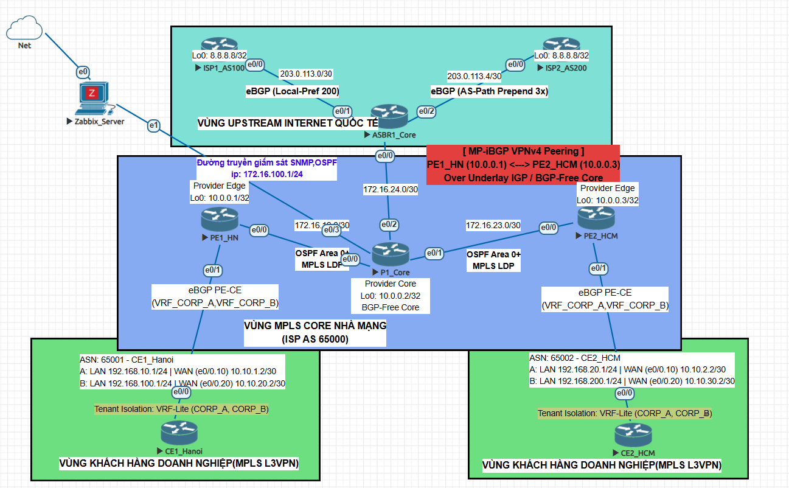

### 2.1 Device Inventory

| Node | Role | Loopback0 | Interfaces | Protocols |
| :--- | :--- | :--- | :--- | :--- |
| **PE1_HN** | Provider Edge (Hanoi) | `10.0.0.1/32` | `e0/0` to P1; `e0/1` trunk to CE1 (`.10` = tenant A, `.20` = tenant B) | OSPF, LDP, MP-iBGP VPNv4, VRF, eBGP |
| **P1_Core** | Provider (P router) | `10.0.0.2/32` | `e0/0` to PE1, `e0/1` to PE2, `e0/2` to ASBR1 | OSPF, LDP (no BGP) |
| **PE2_HCM** | Provider Edge (Ho Chi Minh) | `10.0.0.3/32` | `e0/0` to P1; `e0/1` trunk to CE2 (`.10` = tenant A, `.20` = tenant B) | OSPF, LDP, MP-iBGP VPNv4, VRF, eBGP |
| **ASBR1_Core** | AS border router | `10.0.0.4/32` | `e0/0` to P1, `e0/1` to ISP1, `e0/2` to ISP2 | OSPF, LDP, eBGP |
| **CE1_Hanoi** | Customer Edge (Hanoi) | - | `e0/0` trunk (`.10` = `CORP_A`, `.20` = `CORP_B`) | eBGP (AS 65001), VRF-Lite, 802.1Q |
| **CE2_HCM** | Customer Edge (Ho Chi Minh) | - | `e0/0` trunk (`.10` = `CORP_A`, `.20` = `CORP_B`) | eBGP (AS 65002), VRF-Lite, 802.1Q |
| **ISP1_AS100** | Primary upstream | `8.8.8.8/32` | `e0/0` to ASBR1 | eBGP (AS 100) |
| **ISP2_AS200** | Secondary upstream | `8.8.8.8/32` | `e0/0` to ASBR1 | eBGP (AS 200) |

> Both upstreams advertise `8.8.8.8/32` so one destination is reachable over two paths. Private ASNs and documentation ranges (`203.0.113.0/24`) are used because this is a lab.

### 2.2 Tenants

| Tenant | PE VRF | CE VRF | RD | Export / Import RT | VLAN | Addressing |
| :--- | :--- | :--- | :--- | :--- | :--- | :--- |
| **Customer A** | `VRF_CORP_A` | `CORP_A` | `65000:100` | `65000:100` | 10 | LANs `192.168.10.0/24` (HN), `192.168.20.0/24` (HCM) |
| **Customer B** | `VRF_CORP_B` | `CORP_B` | `65000:200` | `65000:200` | 20 | WAN `10.10.20.0/30` (HN), `10.10.30.0/30` (HCM); LANs `192.168.100.0/24` (HN), `192.168.200.0/24` (HCM) |

> Both tenants still share one physical CE and one PE-CE link per site, separated by VLANs and, on the CE, by VRF-Lite. A dedicated CE per tenant would be the more common real-world design.

---

## 3. Design & Architecture

### 3.1 VRF, RD and RT

- **VRF** splits one router into independent virtual routers, each with its own RIB and CEF table.
- **Route Distinguisher (RD)** is an 8-byte value prepended to a customer IPv4 prefix, forming a 12-byte **VPNv4 prefix** (for example `65000:100:192.168.10.0/24`). It keeps prefixes unique inside BGP even if tenants reuse the same addresses.
- **Route Target (RT)** is an extended community that controls which VRFs import a route. A PE installs a received VPNv4 route into a VRF only if its RT matches that VRF's import RT.

**RD provides uniqueness. RT provides policy.**

### 3.2 VRF-Lite on the CE routers

In the first version of this lab, both PE-CE subinterfaces on each CE belonged to the CE's single global routing table. Every `network` statement in its global BGP process was advertised on both eBGP sessions, so Tenant A's LANs (`192.168.10.0/24`, `192.168.20.0/24`) appeared inside `VRF_CORP_B` on the PE.

The PE VRFs were not the cause. The shared CE was the bridge between the tenants. VRF-Lite addresses this at the source: each CE subinterface and its eBGP session is bound to its own VRF, with its own BGP address family and its own LAN.

### 3.3 Two-label stack

| Label | Position | Distributed by | Purpose |
| :--- | :--- | :--- | :--- |
| **Transport** | Outer (`S=0`) | LDP | Carries the frame across the core to the egress PE |
| **VPN service** | Inner (`S=1`) | MP-iBGP | Selects the destination VRF on the egress PE |

### 3.4 PHP and BGP-free core

- **PHP:** `P1_Core` is the penultimate hop toward each PE loopback. The PE advertises **implicit-null (label 3)** for its own `/32`, so `P1_Core` pops the outer label and the egress PE needs only one lookup (on the VPN label).
- **BGP-free core:** `P1_Core` forwards on labels only. It holds no tenant or Internet routes, so edge route churn does not reach it.

### 3.5 Key configuration excerpts

> Reference excerpts built from the values documented in this README. Replace the `<...>` placeholders and adjust names to match the real device configs. The ASBR excerpt shows the **intended** policy: the capture in Figure 21 shows ISP1-learned prefixes also being advertised to ISP2, so the prefix filter below was not in effect at capture time (see [section 7](#7-known-limitations--future-work)).

```text
! PE: tenant B VRF with its own RD and RT
vrf definition VRF_CORP_B
 rd 65000:200
 address-family ipv4
  route-target export 65000:200
  route-target import 65000:200

! CE (VRF-Lite): tenant B instance
vrf definition CORP_B
 address-family ipv4
interface Ethernet0/0.20
 encapsulation dot1Q 20
 vrf forwarding CORP_B
 ip address 10.10.20.2 255.255.255.252
router bgp 65001
 address-family ipv4 vrf CORP_B
  neighbor 10.10.20.1 remote-as 65000
  neighbor 10.10.20.1 activate
  network 192.168.100.0 mask 255.255.255.0

! P and PE: LDP bound to loopback, IGP synchronization, session protection
mpls ldp router-id Loopback0 force
mpls ldp session protection
router ospf 1
 mpls ldp sync

! ASBR: outbound preference toward ISP1
route-map RM_FROM_ISP1_IN permit 10
 set local-preference 200

! ASBR: AS-path prepending toward ISP2
route-map RM_TO_ISP2_OUT permit 10
 match ip address prefix-list <PL_OWN_PUBLIC>
 set as-path prepend 65000 65000 65000
```

---

## 4. Packet Walk: `CE1_Hanoi` → `CE2_HCM`

### 4.1 Control plane

1. OSPF provides reachability between loopbacks. LDP, running alongside OSPF, binds transport labels to every `/32` loopback FEC.
2. `CE2_HCM` advertises `192.168.20.0/24` from its `CORP_A` VRF to `PE2_HCM` over eBGP.
3. `PE2_HCM` allocates a VPN label, sets next hop `10.0.0.3`, attaches the export RT `65000:100`, and sends the VPNv4 update to `PE1_HN` via MP-iBGP.
4. `PE1_HN` imports the route into `VRF_CORP_A` and resolves next hop `10.0.0.3` through the LDP label learned from `P1_Core`.

### 4.2 Data plane

Label values below match the traceroute capture (Figure 7) and the Wireshark captures (Figures 17 and 18): LDP transport label `18`, VPN label `21`.

```text
1. CE1 -> PE1 : [ IPv4 ]                                  native IPv4 into VRF_CORP_A
2. PE1 -> P1  : [ LDP 18 (S=0) ][ VPN 21 (S=1) ][ IPv4 ]  PE1 imposes two labels
3. P1  -> PE2 : [ VPN 21 (S=1) ][ IPv4 ]                  P1 pops the outer label (PHP)
4. PE2 -> CE2 : [ IPv4 ]                                  PE2 pops the VPN label, forwards in VRF_CORP_A
```

- **PE1_HN (ingress):** performs a VRF lookup, then pushes the VPN label (bottom) and the LDP label (top).
- **P1_Core (transit):** receives both labels. As the penultimate hop for `10.0.0.3/32`, it **pops** the outer label and forwards the frame with only the VPN label.
- **PE2_HCM (egress):** uses the VPN label to select the VRF, pops it, and forwards native IPv4 to `CE2_HCM`.

---

## 5. BGP Traffic Engineering

`ASBR1_Core` terminates eBGP sessions with `ISP1_AS100` (primary) and `ISP2_AS200` (backup).

### 5.1 Outbound: `LOCAL_PREF`

Route-map `RM_FROM_ISP1_IN` sets `LOCAL_PREF 200` on prefixes received from ISP1. Routes from ISP2 keep the default of 100. `LOCAL_PREF` is carried over iBGP throughout AS 65000 and is evaluated **before** `AS_PATH` length in best-path selection, so internal routers prefer the exit through ISP1 and ISP2 acts as backup.

### 5.2 Inbound: `AS_PATH` prepending

`LOCAL_PREF` is not sent across eBGP, so it cannot steer return traffic. Route-map `RM_TO_ISP2_OUT` instead prepends AS 65000 three times when advertising `203.0.113.128/25` to ISP2. Remote networks see:

| Path | `AS_PATH` |
| :--- | :--- |
| via ISP1 | `100 65000 i` |
| via ISP2 | `200 65000 65000 65000 65000 i` (original + 3 prepends) |

Unless a remote AS overrides this with its own policy, it prefers the shorter path through ISP1.

> **Caveat:** prepending *influences* inbound path selection but cannot guarantee it. Remote networks apply their own `LOCAL_PREF` and other policy before `AS_PATH` length.

---

## 6. Verification & Proof of Concept

### 6.1 Underlay: OSPF and LDP

<p align="center">
  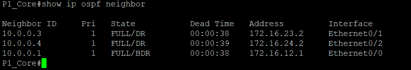
  <br>
  <i><b>Figure 1:</b> <code>show ip ospf neighbor</code> on P1_Core. All transit adjacencies are FULL.</i>
</p>

<p align="center">
  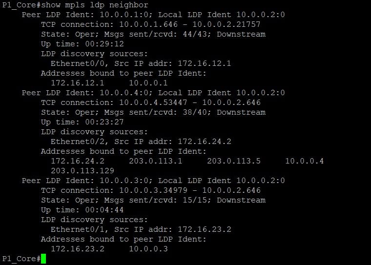
  <br>
  <i><b>Figure 2:</b> <code>show mpls ldp neighbor</code> on P1_Core. All sessions are Oper over TCP 646, anchored to loopbacks through <code>mpls ldp router-id Loopback0 force</code>. The <code>:0</code> suffix denotes a per-platform label space.</i>
</p>

### 6.2 BGP-free core and PHP

<p align="center">
  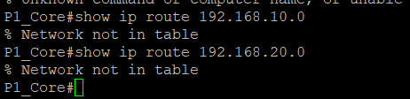
  <br>
  <i><b>Figure 3:</b> <code>show ip route 192.168.20.0</code> on P1_Core returns <code>% Network not in table</code>: tenant prefixes are absent from the core.</i>
</p>

<p align="center">
  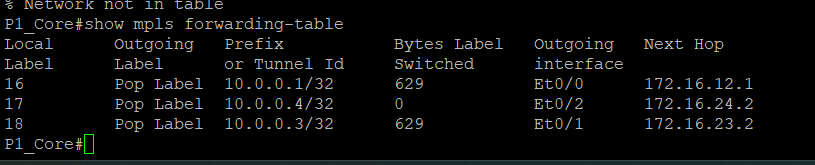
  <br>
  <i><b>Figure 4:</b> <code>show mpls forwarding-table</code> on P1_Core shows <code>Pop Label</code> toward the PE loopbacks, confirming PHP.</i>
</p>

### 6.3 End-to-end L3VPN (`VRF_CORP_A`)

<p align="center">
  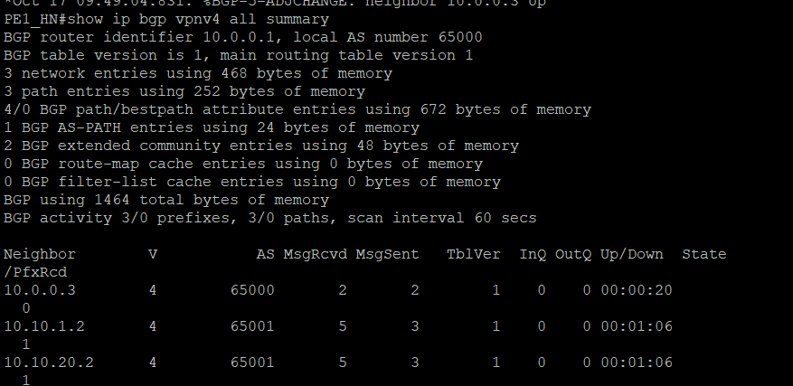
  <br>
  <i><b>Figure 5:</b> <code>show ip bgp vpnv4 all summary</code> on PE1_HN. The MP-iBGP session with <code>10.0.0.3</code> is Established.</i>
</p>

<p align="center">
  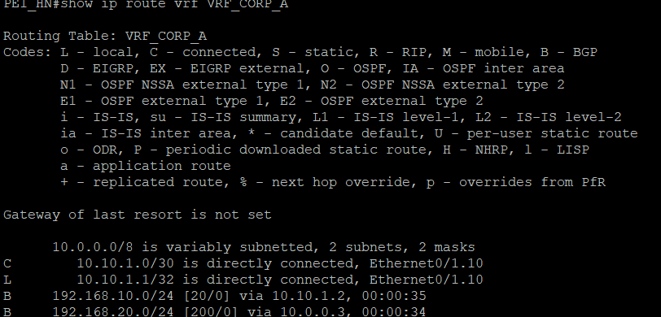
  <br>
  <i><b>Figure 6:</b> <code>show ip route vrf VRF_CORP_A</code> on PE1_HN. The remote LAN <code>192.168.20.0/24</code> is installed via BGP with next hop <code>10.0.0.3</code>.</i>
</p>

<p align="center">
  
  <br>
  <i><b>Figure 7:</b> Traceroute from CE1_Hanoi to CE2_HCM inside <code>VRF_CORP_A</code>. Hop 2 (P1_Core) shows the two-label stack <code>[Labels 18/21]</code>; hop 3 shows the single VPN label <code>[Label 21]</code>, consistent with PHP at P1.</i>
</p>

### 6.4 Tenant isolation with VRF-Lite

**Before VRF-Lite (shared CE routing table)**

<p align="center">
  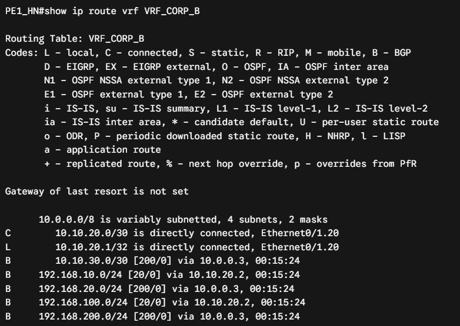
  <br>
  <i><b>Figure 8:</b> <code>show ip route vrf VRF_CORP_B</code> on PE1_HN before VRF-Lite. Tenant A prefixes <code>192.168.10.0/24</code> and <code>192.168.20.0/24</code> appear inside VRF_CORP_B because the shared CE advertised them on both eBGP sessions.</i>
</p>

**After VRF-Lite**

<p align="center">
  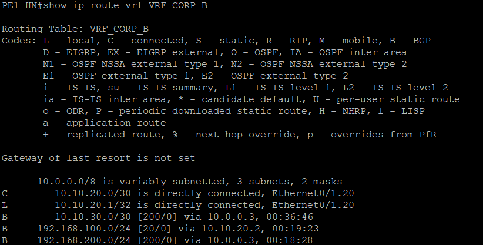
  <br>
  <i><b>Figure 9:</b> <code>show ip route vrf VRF_CORP_B</code> on PE1_HN after VRF-Lite. No Tenant A prefixes remain.</i>
</p>

<p align="center">
  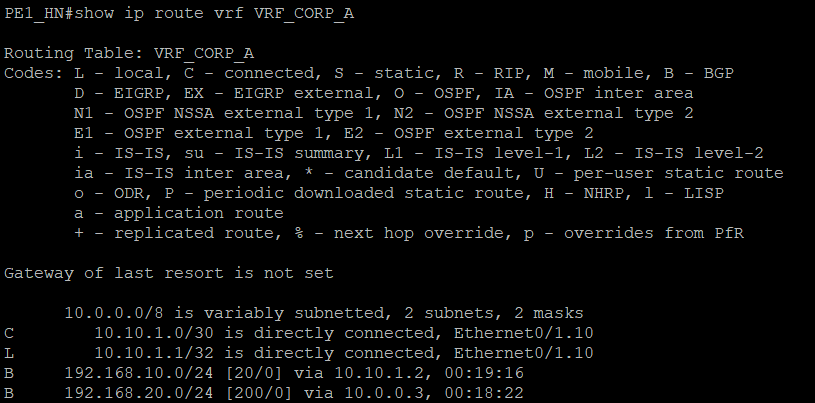
  <br>
  <i><b>Figure 10:</b> <code>show ip route vrf VRF_CORP_A</code> on PE1_HN after VRF-Lite. No Tenant B prefixes (<code>192.168.100.0/24</code>, <code>192.168.200.0/24</code>).</i>
</p>

<p align="center">
  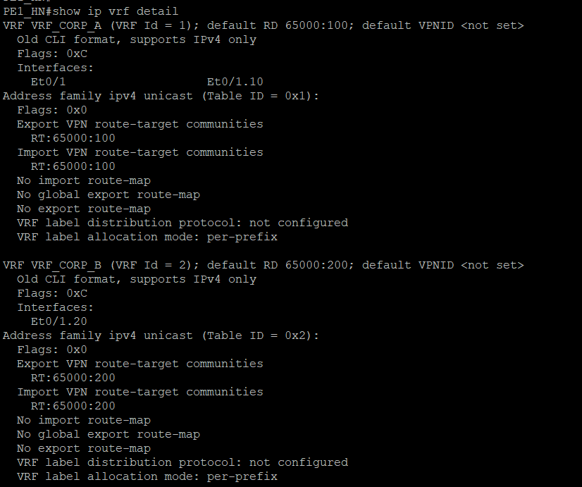
  <br>
  <i><b>Figure 11:</b> <code>show ip vrf detail</code> on PE1_HN showing separate RD and import/export RT for each tenant.</i>
</p>

**Data-plane test (cross-tenant ping and traceroute)**

<p align="center">
  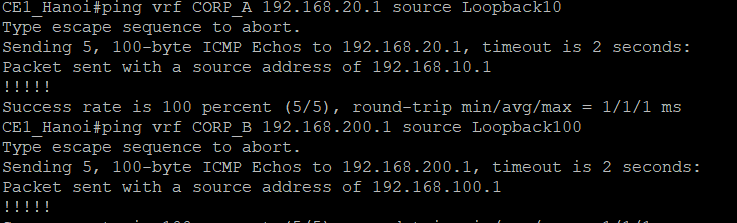
  <br>
  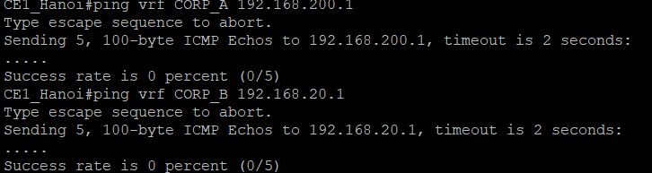
  <br>
  <i><b>Figure 12:</b> Ping within Tenant B succeeds (<code>!!!!!</code>), while ping from Tenant A toward a Tenant B-only prefix fails (<code>% Network not in table</code>).</i>
</p>

<p align="center">
  
  <br>
  <i><b>Figure 12b:</b> Traceroute from CE1_Hanoi to CE2_HCM inside <code>VRF_CORP_B</code>. The inner VPN label is <code>26</code> (compared to <code>21</code> in Tenant A), consistent with per-VRF label allocation across the shared core.</i>
</p>

**Result:** after VRF-Lite, no prefixes of one tenant were observed in the other tenant's VRF, and the cross-tenant ping failed. This tests one direction; the reverse direction (`ping vrf CORP_B 192.168.20.1`) can be added for completeness.

### 6.5 LDP hardening

- **LDP-IGP synchronization:** while the LDP session on a link is not yet established, OSPF advertises the maximum link metric on that link, so traffic is not sent onto a path that has no labels (a blackhole during convergence).
- **LDP session protection:** keeps the LDP session and its label bindings alive through a targeted LDP session when the direct link fails but an alternate path to the neighbor exists.

<p align="center">
  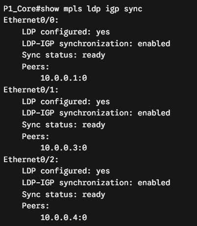
  <br>
  <i><b>Figure 13:</b> <code>show mpls ldp igp sync</code> on P1_Core shows synchronization achieved on the transit interfaces.</i>
</p>

<p align="center">
  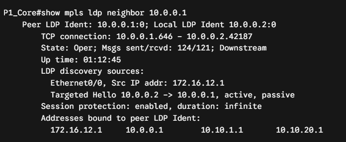
  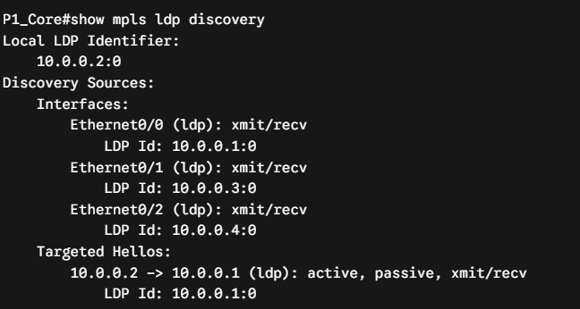
  <br>
  <i><b>Figure 14:</b> <code>show mpls ldp neighbor</code> / <code>show mpls ldp discovery</code> output showing session protection configured.</i>
</p>

> In the current single-P topology there is no alternate path to the PEs, so session protection is configured but cannot show a benefit yet. It becomes testable after a second P router or redundant link is added.

### 6.6 BGP traffic engineering

<p align="center">
  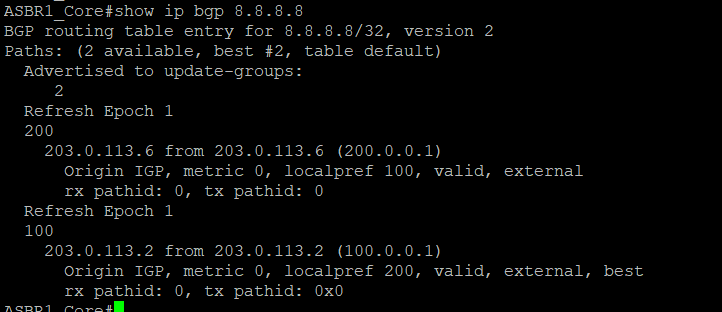
  <br>
  <i><b>Figure 15:</b> <code>show ip bgp 8.8.8.8</code> on ASBR1_Core. The path via ISP1 (<code>203.0.113.2</code>) has <code>localpref 200</code> and is best; the path via ISP2 (<code>203.0.113.6</code>) keeps <code>localpref 100</code>.</i>
</p>

<p align="center">
  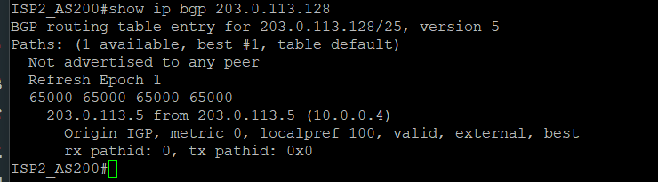
  <br>
  <i><b>Figure 16:</b> <code>show ip bgp 203.0.113.128</code> on ISP2_AS200. The prefix arrives with the elongated path <code>65000 65000 65000 65000 i</code>.</i>
</p>

### 6.7 Packet-level analysis (Wireshark)

This section uses Wireshark captures to verify the MPLS label stack, PHP, MP-iBGP VPNv4 signaling, per-VRF eBGP advertisements and the BGP traffic-engineering behavior.

#### 6.7.1 MPLS L3VPN encapsulation and signaling

**Two-label stack (PE1_HN to P1_Core).** Traffic from `CE1_Hanoi` (`192.168.10.1`) to `CE2_HCM` (`192.168.20.1`) in `VRF_CORP_A` gets a two-label stack from `PE1_HN` before entering the core.

<p align="center">
  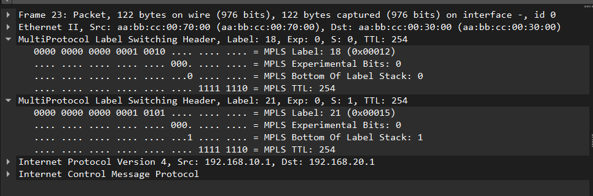
  <br>
  <i><b>Figure 17:</b> Capture on the PE1_HN to P1_Core link showing the two-label stack for Tenant A traffic.</i>
</p>

* **Outer label (LDP transport, `18`, `S=0`):** `S=0` means more labels follow. LDP, running alongside OSPF, distributes it. `P1_Core` inspects only this label to switch the packet toward the egress PE loopback (`10.0.0.3`).
* **Inner label (MP-BGP VPN label, `21`, `S=1`):** `S=1` marks the bottom of the stack, right before the IPv4 header. `PE2_HCM` allocated it for `VRF_CORP_A`, and it is untouched across the core.
* **Payload:** the original ICMP Echo packet (`Src: 192.168.10.1`, `Dst: 192.168.20.1`) is carried unchanged.

**Penultimate Hop Popping (P1_Core to PE2_HCM).** `PE2_HCM` advertises implicit-null (label `3`) via LDP for its loopback, so `P1_Core` pops the transport label.

<p align="center">
  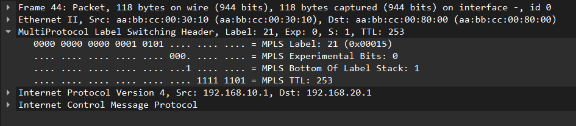
  <br>
  <i><b>Figure 18:</b> Capture on the P1_Core to PE2_HCM link showing only the VPN label remaining (PHP).</i>
</p>

* **Outer label removed:** the transport label (`18`) is gone after `P1_Core`.
* **Single remaining label (`21`, `S=1`):** the MPLS TTL decrements from `254` to `253`, consistent with one transit hop across `P1_Core`.
* **Egress behavior:** `PE2_HCM` looks up label `21`, removes the MPLS header and forwards native IPv4 toward `CE2_HCM`.

**MP-iBGP VPNv4 update and Route Target.** The PEs peer over Loopback0 using `AFI 1 / SAFI 128`.

<p align="center">
  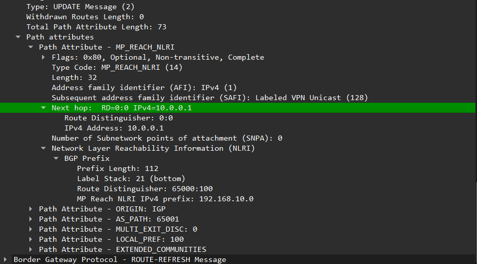
  <br>
  <i><b>Figure 19:</b> MP-iBGP UPDATE advertising Tenant A reachability and attributes.</i>
</p>

* **`MP_REACH_NLRI` (`AFI 1 / SAFI 128`):** labeled VPNv4 unicast.
* **Route Distinguisher (`65000:100`):** prepended to the advertised customer prefix, forming a 12-byte VPNv4 prefix.
* **Label:** the update carries the VPN label bound to that prefix.
* **Extended community (`Route Target 65000:100`):** the receiving PE compares it with its `route-target import` policy before installing the route into `VRF_CORP_A`.

#### 6.7.2 Tenant separation on the PE-CE trunk (VRF-Lite)

<p align="center">
  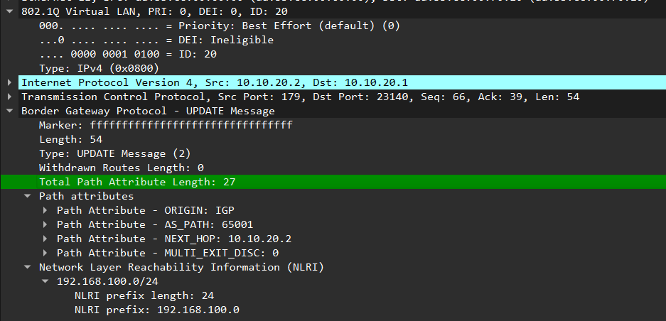
  <br>
  <i><b>Figure 20:</b> BGP UPDATE captured on the PE1-CE1 trunk (VLAN 20) after VRF-Lite.</i>
</p>

* **802.1Q (`VLAN ID 20`):** the eBGP session between `CE1_Hanoi` (`10.10.20.2`) and `PE1_HN` (`10.10.20.1`) runs on subinterface `Ethernet0/0.20`, so Tenant B control-plane traffic is tagged separately at Layer 2.
* **NLRI:** the captured UPDATE advertises only Tenant B's subnet (`192.168.100.0/24`). Tenant A prefixes (`192.168.10.0/24`) are not present in it, which is consistent with VRF-Lite keeping them inside `CORP_A`.

#### 6.7.3 BGP traffic engineering and failover (ISP1 / ISP2)

`ASBR1_Core` has eBGP sessions with **ISP1 (`AS 100`)** and **ISP2 (`AS 200`)**. ISP1 is the primary path and ISP2 the backup.

**Inbound: AS-path prepending.**

<p align="center">
  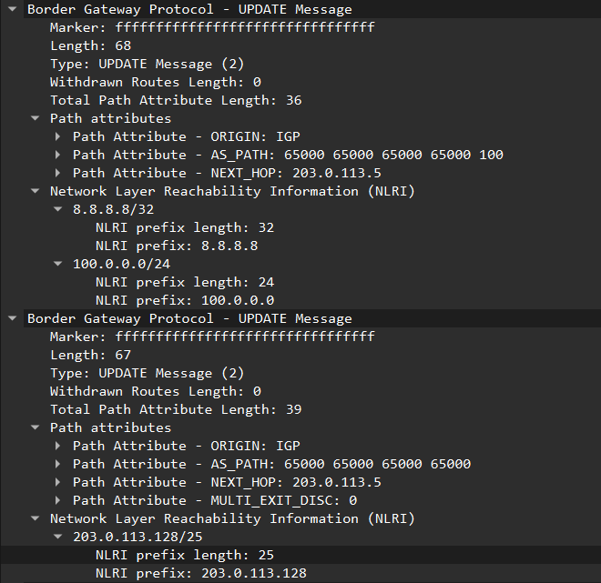
  <br>
  <i><b>Figure 21:</b> BGP UPDATE messages from ASBR1_Core to ISP2_AS200 showing 3x AS-path prepending.</i>
</p>

* **Path (`65000 65000 65000 65000`):** with three extra prepends, the path advertised to ISP2 is four ASNs long. Upstream speakers running standard best-path selection prefer the shorter path via ISP1, unless their own policy says otherwise.
* **Two UPDATE messages in one TCP segment:** BGP groups prefixes that share the same path attributes.
  * The first UPDATE carries prefixes learned from AS 100 (`8.8.8.8/32`, `100.0.0.0/24`) with the path `65000 65000 65000 65000 100`.
  * The second UPDATE carries the locally originated block `203.0.113.128/25` with the path `65000 65000 65000 65000` and `MULTI_EXIT_DISC (MED: 0)`.
* **Observation:** the first UPDATE shows that ISP1-learned prefixes are also being advertised to ISP2. AS 65000 could therefore act as a transit between the two upstreams. The intended policy (own prefix only) is in section 3.5, and the fix is listed in section 7.

**Outbound: `LOCAL_PREF` and failover.** Routes from `ISP1_AS100` get `Local-Pref 200`, routes from `ISP2_AS200` keep the default `100`. Outbound behavior was checked with continuous ICMP to `8.8.8.8`, generated on `ASBR1_Core`, before and after shutting the ISP1 interface.

<p align="center">
  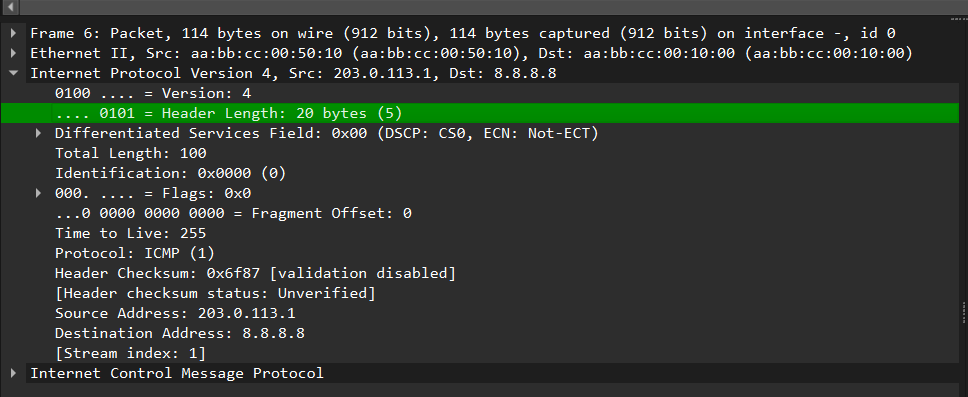
  <br>
  <i><b>Figure 22:</b> Normal state. Outbound ICMP to 8.8.8.8 exits via the ISP1 link (source IP <code>203.0.113.1</code>).</i>
</p>

* **Primary path:** ICMP Echo Requests leave through `Ethernet0/1` (`Src: 203.0.113.1`, subnet `203.0.113.0/30`), consistent with `Local-Pref 200` making ISP1 the active next hop.

<p align="center">
  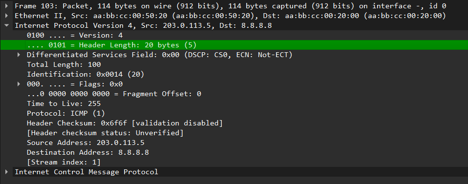
  <br>
  <i><b>Figure 23:</b> After the ISP1 interface is shut down, outbound ICMP leaves via the ISP2 link (source IP <code>203.0.113.5</code>).</i>
</p>

* **Failover:** after `Ethernet0/1` is administratively shut down, ICMP packets leave through `Ethernet0/2` (`Src: 203.0.113.5`, subnet `203.0.113.4/30`), so the traffic moved to the ISP2 path without manual changes.
* **Limits of this test:** the interruption time and packet loss were **not measured**, so no convergence figure is claimed. Because the pings originate on `ASBR1_Core`, this checks the ASBR's own egress choice, not the return path or traffic from inside AS 65000.

---

## 7. Known Limitations & Future Work

**Redundancy**
- Single P router and a single PE per site: no core redundancy and no link-failure test.
- ISP failover is shown (Figures 22 and 23) but not measured: packet loss and interruption time still need to be recorded, along with the failback to ISP1.

**Security and filtering**
- **Observed (Figure 21):** `ASBR1_Core` advertises ISP1-learned prefixes to ISP2, so AS 65000 could become a transit between the two upstreams. Proposed fix, not yet applied:

```text
ip prefix-list PL_OWN_PUBLIC seq 5 permit 203.0.113.128/25

route-map RM_TO_ISP2_OUT permit 10
 match ip address prefix-list PL_OWN_PUBLIC
 set as-path prepend 65000 65000 65000

route-map RM_TO_ISP1_OUT permit 10
 match ip address prefix-list PL_OWN_PUBLIC

router bgp 65000
 neighbor <ISP1 peer> route-map RM_TO_ISP1_OUT out
 neighbor <ISP2 peer> route-map RM_TO_ISP2_OUT out
```

- No other ASBR prefix filters (bogons, RFC 1918) and no `maximum-prefix`.
- No BGP or LDP authentication.

**Convergence and operations**
- No BFD or timer tuning, so no fast-convergence claim is made.
- No monitoring (syslog, SNMP, NetFlow) and no automated configuration management.

**Design notes**
- Both tenants share a physical CE and PE-CE link (separated by VLANs and VRF-Lite). A dedicated CE per tenant is more typical.
- A Route Reflector would remove the PE full-mesh requirement. Use a **dedicated RR**; running BGP on `P1_Core` would end its BGP-free role.

**Next steps**
1. Apply the outbound prefix filters above and capture the UPDATE toward ISP2 again to show only `203.0.113.128/25` is advertised.
2. ISP1 failure and recovery test with ping loss and convergence time, using a source inside the `203.0.113.128/25` block so the return path is also tested.
3. Overlapping address space: give both tenants the same LAN prefix at different sites and show that both VRFs keep independent routes.
4. ASBR bogon filtering and BGP authentication.
5. A second P router for core redundancy, which also lets LDP session protection be demonstrated.
6. BFD on eBGP peers, with measured (not assumed) convergence times.
7. Publish device configs in a `configs/` folder so the lab can be reproduced.
