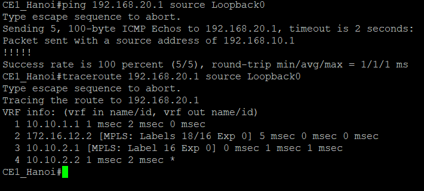

# MPLS L3VPN & Dual-Homed BGP Traffic Engineering Lab

A service-provider lab built around a small ISP backbone (**AS 65000**), running on Cisco IOL in EVE-NG. It demonstrates two architectures:

1. **Multi-tenant MPLS L3VPN (RFC 4364)** over a **BGP-free core**.
2. **Dual-homed eBGP edge traffic engineering** toward two upstream providers, using `LOCAL_PREF` for outbound traffic and `AS_PATH` prepending to influence inbound traffic.


---

## Table of Contents

1. [Project Overview](#1-project-overview)
2. [Topology & Addressing](#2-topology--addressing)
3. [Design & Architecture](#3-design--architecture)
4. [Packet Walk](#4-packet-walk-ce1_hanoi--ce2_hcm)
5. [BGP Traffic Engineering](#5-bgp-traffic-engineering)
6. [Verification](#6-verification)
7. [Known Limitations & Future Work](#7-known-limitations--future-work)

---

## 1. Project Overview

| Domain | Implementation |
| :--- | :--- |
| **IGP underlay** | Single-area OSPFv2 (Area 0) on provider links; `/32` Loopback0 interfaces are router IDs and transport endpoints |
| **MPLS transport** | LDP (RFC 5036) binds labels to the `/32` PE loopbacks |
| **Tenant isolation** | `VRF_CORP_A` and `VRF_CORP_B` on `PE1_HN` and `PE2_HCM`, each with its own RD and RT |
| **VPN signaling** | MP-iBGP VPNv4 between `PE1_HN` (`10.0.0.1`) and `PE2_HCM` (`10.0.0.3`) |
| **PE-CE routing** | eBGP over 802.1Q subinterfaces (`CE1_Hanoi` = AS 65001, `CE2_HCM` = AS 65002) |
| **BGP-free core** | `P1_Core` runs only OSPF and LDP, with no BGP sessions and no tenant or Internet prefixes |
| **Upstream peering** | `ASBR1_Core` has eBGP to `ISP1_AS100` (AS 100) and `ISP2_AS200` (AS 200) |
| **Outbound TE** | Inbound route-map sets `LOCAL_PREF 200` on routes from ISP1 (primary egress) |
| **Inbound TE** | Outbound route-map prepends AS 65000 three times toward ISP2 (backup ingress) |

---

## 2. Topology & Addressing


### 2.1 Device Inventory

| Node | Role | Loopback0 | Interfaces | Protocols |
| :--- | :--- | :--- | :--- | :--- |
| **PE1_HN** | Provider Edge (Hanoi) | `10.0.0.1/32` | `e0/0` to P1; `e0/1` trunk (`e0/1.10` in `VRF_CORP_A`, `e0/1.20` in `VRF_CORP_B`) | OSPF, LDP, MP-iBGP VPNv4, VRF, eBGP |
| **P1_Core** | Provider (P router) | `10.0.0.2/32` | `e0/0` to PE1, `e0/1` to PE2, `e0/2` to ASBR1 | OSPF, LDP (no BGP) |
| **PE2_HCM** | Provider Edge (Ho Chi Minh) | `10.0.0.3/32` | `e0/0` to P1; `e0/1` trunk (`e0/1.10` in `VRF_CORP_A`, `e0/1.20` in `VRF_CORP_B`) | OSPF, LDP, MP-iBGP VPNv4, VRF, eBGP |
| **ASBR1_Core** | AS border router | `10.0.0.4/32` | `e0/0` to P1, `e0/1` to ISP1, `e0/2` to ISP2 | OSPF, LDP, eBGP |
| **CE1_Hanoi** | Customer Edge (Hanoi) | - | `e0/0` trunk (`.10` = CORP_A, `.20` = CORP_B) | eBGP (AS 65001), 802.1Q |
| **CE2_HCM** | Customer Edge (Ho Chi Minh) | - | `e0/0` trunk (`.10` = CORP_A, `.20` = CORP_B) | eBGP (AS 65002), 802.1Q |
| **ISP1_AS100** | Primary upstream | `8.8.8.8/32` | `e0/0` to ASBR1 | eBGP (AS 100) |
| **ISP2_AS200** | Secondary upstream | `8.8.8.8/32` | `e0/0` to ASBR1 | eBGP (AS 200) |

> Both upstreams advertise `8.8.8.8/32` so one destination is reachable over two paths. Private ASNs and documentation ranges (`203.0.113.0/24`) are used because this is a lab.

### 2.2 Tenants

| Tenant | VRF | RD | Export / Import RT | VLAN | Addressing |
| :--- | :--- | :--- | :--- | :--- | :--- |
| **Customer A** | `VRF_CORP_A` | `65000:100` | `65000:100` | 10 (`e0/1.10`) | LANs `192.168.10.0/24` (HN), `192.168.20.0/24` (HCM) |
| **Customer B** | `VRF_CORP_B` | `65000:200` | `65000:200` | 20 (`e0/1.20`) | WAN `10.10.20.0/30` (HN), `10.10.30.0/30` (HCM); LANs `192.168.100.0/24` (HN), `192.168.200.0/24` (HCM) |

> **Lab simplification:** both tenants share one CE per site and one physical PE-CE link, separated by VLANs. Real deployments usually give each customer its own CE. The consequences are analyzed in [section 6.5](#65-second-tenant-vrf_corp_b-and-shared-ce-analysis).

---

## 3. Design & Architecture

### 3.1 VRF, RD and RT

- **VRF** splits one PE into independent virtual routers, each with its own RIB and CEF table.
- **Route Distinguisher (RD)** is an 8-byte value prepended to a customer IPv4 prefix, forming a 12-byte **VPNv4 prefix** (for example `65000:100:192.168.10.0/24`). It keeps prefixes unique inside BGP, even if tenants reuse the same addresses.
- **Route Target (RT)** is an extended community that controls which VRFs import a route. A PE installs a received VPNv4 route into a VRF only if the route's RT matches that VRF's import RT.

**RD provides uniqueness. RT provides policy.**

### 3.2 Two-label stack

| Label | Position | Distributed by | Purpose |
| :--- | :--- | :--- | :--- |
| **Transport** | Outer (`S=0`) | LDP | Carries the frame across the core to the egress PE |
| **VPN service** | Inner (`S=1`) | MP-iBGP | Selects the destination VRF on the egress PE |

### 3.3 PHP and BGP-free core

- **PHP:** `P1_Core` is the penultimate hop toward each PE loopback. The PE advertises **implicit-null (label 3)** for its own `/32`, so `P1_Core` pops the outer label and the egress PE needs only one lookup (on the VPN label).
- **BGP-free core:** `P1_Core` forwards on labels only. It holds no tenant or Internet routes, so edge route churn does not reach it.

### 3.4 Key configuration excerpts

> Reference excerpts built from the values documented in this README. Adjust them to match your actual device configs.

```text
! PE: tenant B VRF with its own RD and RT
vrf definition VRF_CORP_B
 rd 65000:200
 address-family ipv4
  route-target export 65000:200
  route-target import 65000:200

! P and PE: LDP bound to the loopback
mpls ldp router-id Loopback0 force

! ASBR: outbound preference toward ISP1
route-map RM_FROM_ISP1_IN permit 10
 set local-preference 200

! ASBR: AS-path prepending toward ISP2
route-map RM_TO_ISP2_OUT permit 10
 match ip address prefix-list PL_OWN_PUBLIC
 set as-path prepend 65000 65000 65000
```

---

## 4. Packet Walk: `CE1_Hanoi` → `CE2_HCM`

### 4.1 Control plane

1. OSPF provides reachability between loopbacks. LDP binds transport labels to every `/32` loopback FEC.
2. `CE2_HCM` advertises `192.168.20.0/24` to `PE2_HCM` over eBGP.
3. `PE2_HCM` allocates a VPN label (example: `19`), sets next hop `10.0.0.3`, attaches the export RT, and sends the VPNv4 update to `PE1_HN` via MP-iBGP.
4. `PE1_HN` resolves next hop `10.0.0.3` through the LDP label learned from `P1_Core` (example: `16`).

### 4.2 Data plane

```text
1. CE1 -> PE1 : [ IPv4 ]                                  native IPv4 ingress
2. PE1 -> P1  : [ LDP 16 (S=0) ][ VPN 19 (S=1) ][ IPv4 ]  PE1 imposes two labels
3. P1  -> PE2 : [ VPN 19 (S=1) ][ IPv4 ]                  P1 pops the outer label (PHP)
4. PE2 -> CE2 : [ IPv4 ]                                  PE2 pops the VPN label, forwards in the VRF
```

> Labels `16` and `19` are illustrative. Real values are visible in the verification screenshots.

- **PE1_HN (ingress):** performs a VRF lookup, then pushes the VPN label (bottom) and the LDP label (top).
- **P1_Core (transit):** acts on the top label only. Here it pops it because of PHP. Traceroute shows the two-label stack on the packet *arriving* at this hop.
- **PE2_HCM (egress):** uses the VPN label to pick the VRF, pops it, and forwards native IPv4 to the CE.

---

## 5. BGP Traffic Engineering

`ASBR1_Core` terminates eBGP sessions with `ISP1_AS100` (primary) and `ISP2_AS200` (backup).

### 5.1 Outbound: `LOCAL_PREF`

Route-map `RM_FROM_ISP1_IN` sets `LOCAL_PREF 200` on prefixes received from ISP1. Routes from ISP2 keep the default of 100. `LOCAL_PREF` is carried over iBGP throughout AS 65000 and is evaluated **before** `AS_PATH` length in best-path selection, so internal routers prefer the exit through ISP1 and ISP2 acts as backup.

### 5.2 Inbound: `AS_PATH` prepending

`LOCAL_PREF` is not sent across eBGP, so it cannot steer return traffic. Instead, route-map `RM_TO_ISP2_OUT` prepends AS 65000 three times when advertising `203.0.113.128/25` to ISP2. Remote networks see:

| Path | `AS_PATH` |
| :--- | :--- |
| via ISP1 | `100 65000 i` |
| via ISP2 | `200 65000 65000 65000 65000 i` (original + 3 prepends) |

Unless a remote AS overrides this with its own policy, it prefers the shorter path through ISP1.

> **Caveat:** prepending *influences* inbound path selection but cannot guarantee it. Remote networks apply their own `LOCAL_PREF` and other policy before `AS_PATH` length.

---

## 6. Verification

### 6.1 Underlay: OSPF and LDP
<p align="center">
  
  <br>
  <i><b>Figure 1:</b> <code>show ip ospf neighbor</code> on P1_Core. All transit adjacencies are FULL.</i>
</p>

<br>

<p align="center">
  
  <br>
  <i><b>Figure 2:</b> <code>show mpls ldp neighbor</code> on P1_Core. All LDP sessions are Oper over TCP 646, anchored to loopbacks through <code>mpls ldp router-id Loopback0 force</code>. The :0 suffix denotes a per-platform label space.</i>
</p>

### 6.2 BGP-free core


- `show ip route 192.168.20.0` on `P1_Core` returns `% Network not in table`: tenant prefixes are absent from the core.
- `show mpls forwarding-table` shows `Pop Label` toward the PE loopbacks, confirming PHP.

### 6.3 End-to-end L3VPN (`VRF_CORP_A`)




- The MP-iBGP VPNv4 session between `10.0.0.1` and `10.0.0.3` is `Established`.
- In `VRF_CORP_A`, `192.168.20.0/24` is installed via BGP with recursive next hop `10.0.0.3`.
- Traceroute from `CE1_Hanoi` to `CE2_HCM` shows the label stack at the core hop, and the ping succeeds (`!!!!!`).

### 6.4 Upstream traffic engineering


- `show ip bgp 8.8.8.8` on `ASBR1_Core`: the path via ISP1 (`203.0.113.2`) has `LocPrf 200` and is best (`*>`); the path via ISP2 (`203.0.113.6`) keeps `LocPrf 100`.
- `show ip bgp 203.0.113.128` on `ISP2_AS200`: the prefix arrives with the elongated path `65000 65000 65000 65000 i`.

### 6.5 Second tenant (`VRF_CORP_B`) and shared-CE analysis


**Verified**

- `show ip vrf` on `PE1_HN`: `VRF_CORP_A` (RD `65000:100`) is bound to `Et0/1` and `Et0/1.10`; `VRF_CORP_B` (RD `65000:200`) is bound to `Et0/1.20`.
- `show ip route vrf VRF_CORP_B` on `PE1_HN`:

| Prefix | Type | Source |
| :--- | :--- | :--- |
| `10.10.20.0/30`, `10.10.20.1/32` | `C` / `L` | `Ethernet0/1.20` |
| `192.168.100.0/24` | `B` `[20/0]` | eBGP from `CE1_Hanoi` via `10.10.20.2` |
| `192.168.200.0/24`, `10.10.30.0/30` | `B` `[200/0]` | MP-iBGP from `PE2_HCM` via `10.0.0.3` |
| `192.168.10.0/24` | `B` `[20/0]` | eBGP via `10.10.20.2` (see analysis) |
| `192.168.20.0/24` | `B` `[200/0]` | MP-iBGP via `10.0.0.3` (see analysis) |

**Pending validation for strict isolation**

- [ ] `show ip vrf detail VRF_CORP_B` shows export and import RT `65000:200`
- [ ] `show ip route vrf VRF_CORP_A` does **not** contain `192.168.100.0/24` or `192.168.200.0/24`
- [ ] `ping vrf VRF_CORP_B 192.168.200.1` from `PE1_HN` succeeds
- [ ] `ping vrf VRF_CORP_A 192.168.200.1` from `PE1_HN` **fails** (cross-tenant isolation)
- [ ] `show ip bgp vpnv4 vrf VRF_CORP_B summary` shows CE peer `10.10.20.2` as `Established`

**Root-cause analysis: Customer A prefixes inside `VRF_CORP_B`**

Both subinterfaces (`.10` and `.20`) on `CE1_Hanoi` (AS 65001) and `CE2_HCM` (AS 65002) terminate in the CE's single global routing table. Every `network` statement in the CE's global BGP process is therefore advertised on **both** eBGP sessions. `CE1_Hanoi` sends `192.168.10.0/24` over the VLAN 20 session (`10.10.20.2`) into `VRF_CORP_B`, and `CE2_HCM` does the same for `192.168.20.0/24`.

The PE-side VRFs are not the source of this leak. The shared CE is the bridge between the two tenants, so this lab does **not yet demonstrate true tenant-level isolation or overlapping IPv4 addressing**.

**Remediation options**

1. Apply an outbound `ip prefix-list` per eBGP neighbor on each CE so each session advertises only that tenant's LANs.
2. Use VRF-Lite on the CEs, or dedicated CE nodes per tenant, to separate the control plane at the customer site. This also enables a real overlapping-address test.

```text
! Proposed fix on CE1_Hanoi (not yet applied)
ip prefix-list PL_A_OUT seq 5 permit 192.168.10.0/24
ip prefix-list PL_B_OUT seq 5 permit 192.168.100.0/24
router bgp 65001
 neighbor <PE1 VLAN10 peer> prefix-list PL_A_OUT out
 neighbor 10.10.20.2        prefix-list PL_B_OUT out
```

> `PE1_HN` also shows the physical `Et0/1` bound to `VRF_CORP_A` alongside `Et0/1.10`. For a clean trunk design, review whether the physical interface needs to be in a VRF at all.
